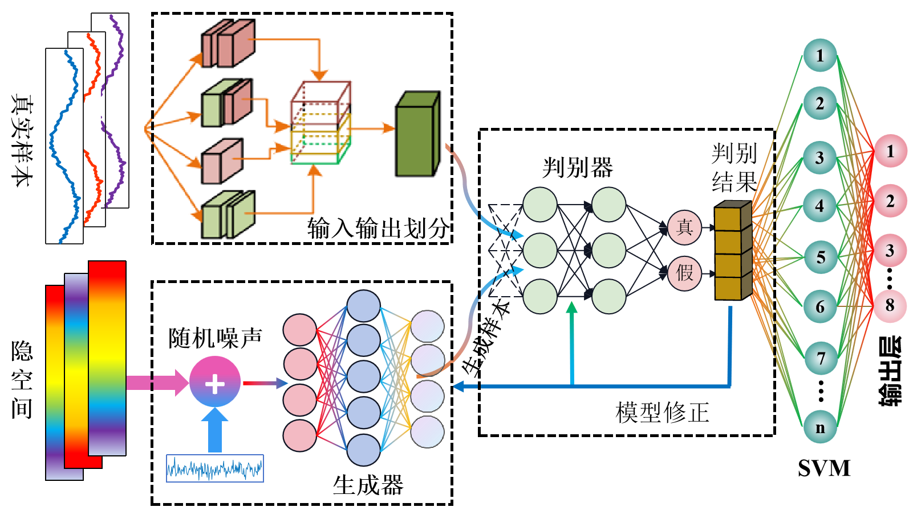
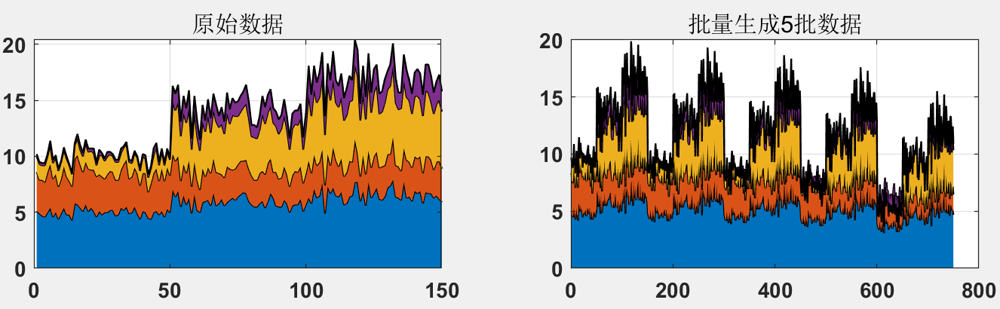
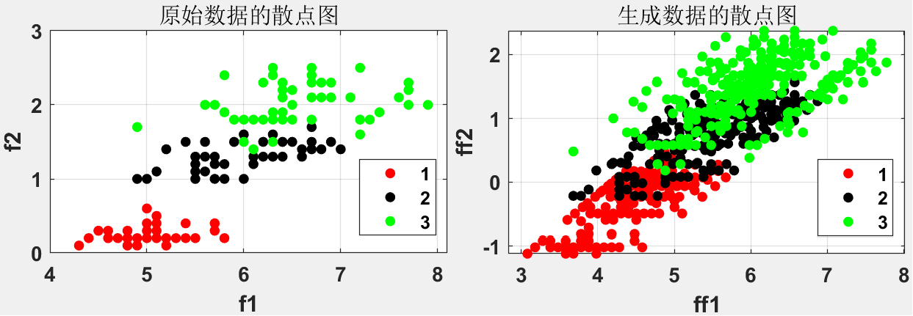
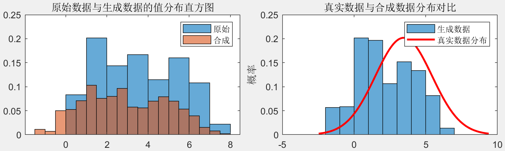
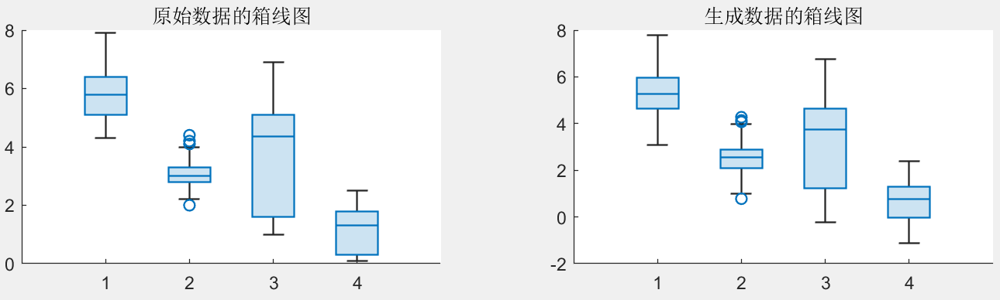
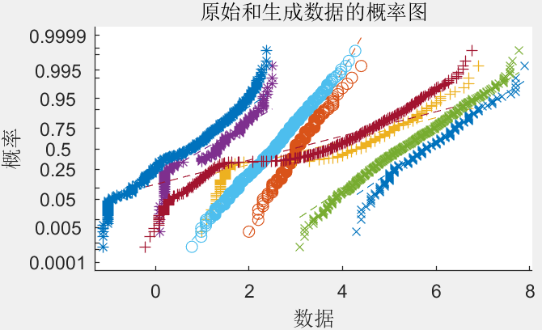
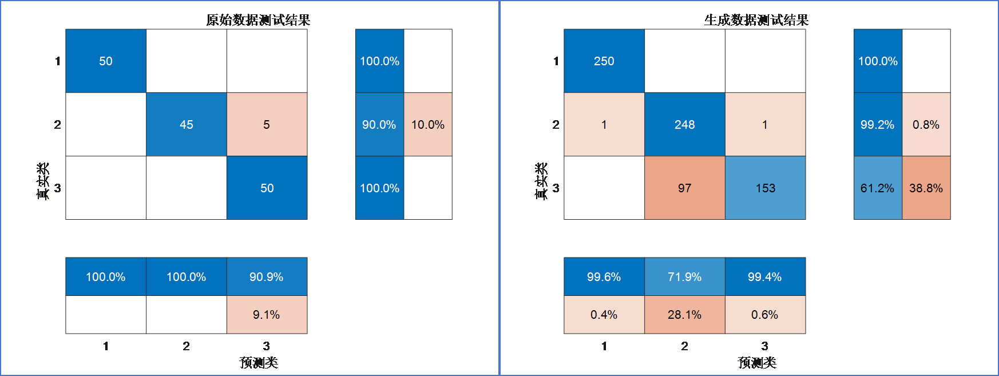

# Ready-made innovative idea! Small sample + fault identification! 1DGAN-SVM batch generation of samples - integrated program for fault identification! MATLAB program, directly run.

Applicable Platform: MATLAB 2022 and Above
In the field of machine learning and deep learning, the diversity and quantity of data directly impact the performance of models. The Generative Adversarial Network (GAN) generates highly realistic data samples through an adversarial process, increasing the diversity of training data and thereby enhancing the generalization capability of the model. This paper integrates the GAN with a fault identification program to achieve an integrated "Batch Generation Sample-Fault Identification" program. There is currently no literature applying this algorithm, so grabbing it first will be beneficial!
①Data Preparation
Read original data from an Excel file (using the Iris dataset as an example), perform preprocessing such as converting feature matrices to vectors, and calculate the mean and standard deviation of the data.
②Defining Generator and Discriminator
Generator (Generator): Initially defined as an identity map, outputting noise data equal to the input.
Discriminator (Discriminator): Defined using Z-score normalization for evaluating the deviation of data from the original dataset.
③Training the GAN
Use a loop for training the GAN, including multiple batches in each cycle.
For each batch, first generate random noise for the generator, then use the generator to produce synthetic data.
Train the discriminator to distinguish between real data and synthetic data, updating the parameters of both the discriminator and generator to optimize their performance.
④Data Generation
After training, use the trained generator to generate a large number of synthetic data.
Reshape and add labels to the generated data to form a new synthetic dataset.
Generate five times the amount of raw data:
Stacked region plot of raw data: This plot shows the stacked region plot of various features in the raw dataset. Different colors represent different feature values. From the plot, one can observe the trend of data changes over time or sample index, which helps understand the interrelationships among features and their temporal responses.
1. Data Stacking Region Map: A stacked map similar to the original data, but here it shows data generated through a Generative Adversarial Network (GAN). Comparing these two maps can show that the generated data maintains overall trends consistent with the original data, indicating that the generation model can effectively mimic the characteristics of the original data.
5. Data Visualization
Use various charts (such as scatter plots, histograms, boxplots, etc.) to display the feature distribution and comparison of the original data and synthetic data, verifying the quality of the generated data.
Using two features (F1 and F2) as axes, different colors represent different categories.
Scatter plots show the distribution of data points in these two feature spaces, with the distribution of the original data and newly generated data being similar, and the generated data being more dense and having sufficient data volume.
Shows the distribution of a certain feature in both the original data and the generated data. Histograms compare their statistical distributions on this feature are similar. Can follow the distribution characteristics of the original data.
Boxplots help quickly identify outliers and distribution ranges in the data; corresponding to the original data's boxplots, show the same statistical information for the generated data. Comparing the boxplots of both can evaluate the similarity of the statistical characteristics of the generated data.
Below is a probability-probability (P-P) plot, used to compare the similarity of two probability distributions. The closer the data points to the diagonal, indicating that the generated data and the original data have a higher similarity in statistical distribution.
By combining these charts, we can comprehensively evaluate the quality of data generated by GANs, checking its similarity to the original data in multiple aspects, thereby validating the effectiveness and applicability of the GAN model.
Fault Identification Results
The accuracy of training an SVM with generated data is: 96.5333%; after training, the test accuracy of the original dataset is: 96.6667%, indicating that the newly generated data can generate highly realistic data samples, increasing the diversity of training data, thereby improving the generalization ability of the model.
Partial Program
Pay attention to our updates regularly to push forward innovative, high-quality learning materials, articles, and code programs, fueling your research efforts!

## Images

<!-- PAYMENT_BLOCK -->

## Get this dataset

- Payment link (Stripe): [Buy now](https://buy.stripe.com/3cs8yP7sY87d0vu9AB)
- Payment QR code: 

<!-- /PAYMENT_BLOCK -->
